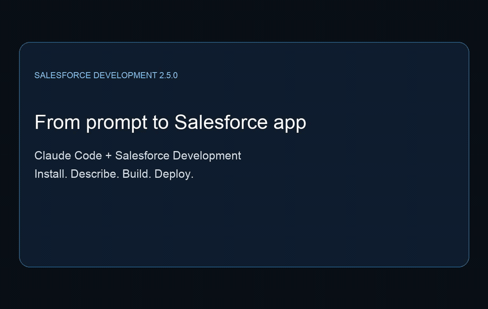
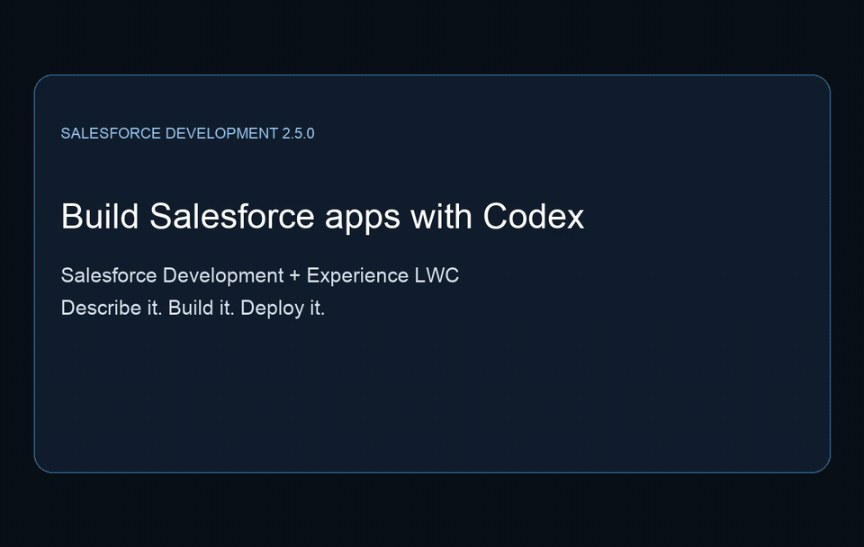
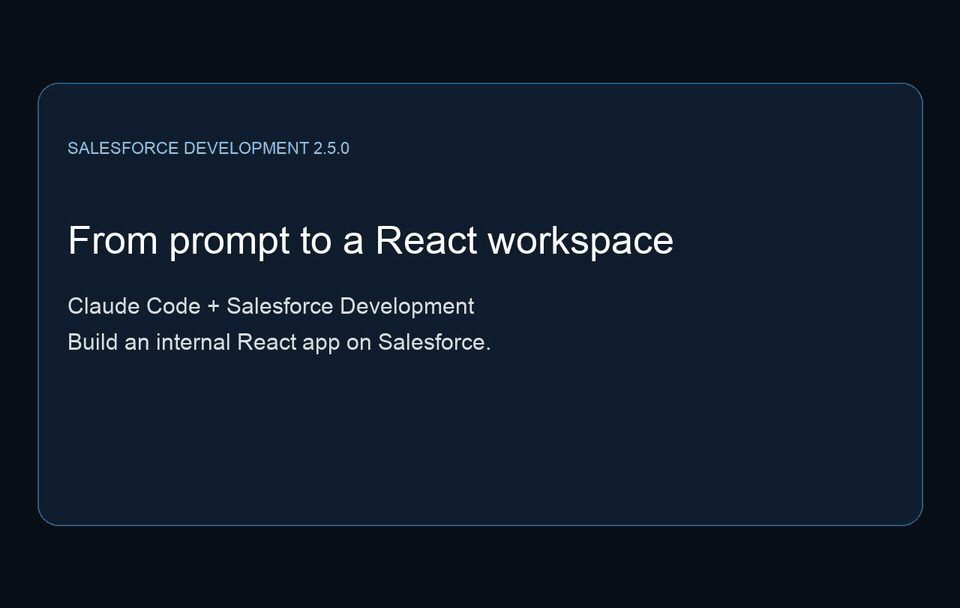

# Salesforce Skills and Plugins Library

This repository provides Salesforce agent skills, plugins, and sample apps for building applications. It includes skills for Agentforce agents, Lightning apps, Flow, Apex, SOQL, Lightning Web Components (LWC), UI bundles, objects and fields, permission sets, and related areas. The [builder plugins](plugins/builder/) package skills with additional capabilities such as agents, hooks, commands, and Model Context Protocol (MCP) servers. Each client loads the components supported by that plugin's manifest.

The skills are contributed by Salesforce and the broader community. The skills library is optimized for Agentforce Vibes and can be used with any AI tool that supports skills. For guided Salesforce development, start with the [Salesforce Development plugin README](plugins/builder/salesforce-development/README.md) and the [Salesforce Development plugin documentation](https://developer.salesforce.com/docs/platform/salesforce-skills-plugins/guide/salesforce-development-overview.html).

## See the development workflow

Go from a natural-language request to an app deployed in Salesforce. These short demos
were recorded with Salesforce Development 2.5.0 and show a terminal workflow followed by the finished app.



| Demo | Length | Watch or download |
|---|---:|---|
| Claude Code: Lightning app | 35 seconds | [GIF](docs/media/development-demos/claude-salesforce-development-2.5.0.gif) · [MP4](docs/media/development-demos/claude-salesforce-development-2.5.0.mp4) |
| Codex CLI: Lightning app | 30 seconds | [GIF](docs/media/development-demos/codex-salesforce-development-2.5.0.gif) · [MP4](docs/media/development-demos/codex-salesforce-development-2.5.0.mp4) |
| Claude Code: internal React app | 32 seconds | [GIF](docs/media/development-demos/claude-react-salesforce-development-2.5.0.gif) · [MP4](docs/media/development-demos/claude-react-salesforce-development-2.5.0.mp4) |

The Codex Lightning demo also uses Experience LWC 0.3.0; the React demo uses
Experience React 0.2.1. The clips combine real terminal excerpts with captured views
of the deployed apps. Accelerated terminal sections are labeled. All Account data
shown is fictional. See the [recording notes](docs/media/development-demos/README.md).

<details>
<summary>Preview Codex CLI and React</summary>

### Codex CLI: Lightning app



### Claude Code: internal React app



</details>

> ⚠️ **Expect frequent changes.** The Salesforce skills and plugins library is evolving rapidly as we refine patterns and incorporate feedback. Skills and plugins may be renamed, restructured, or removed between releases — they do not follow the same stability guarantees as GA platform APIs. If you’ve forked or synced the repository, be prepared for upstream changes that may conflict with local modifications. This repository is always the source of truth.

## 🗂️ Structure

```
sf-skills/
├── .claude-plugin/
│   └── marketplace.json  # Salesforce plugin marketplace catalog
├── plugins/
│   └── builder/          # Plugins for Salesforce development
│       ├── salesforce-development/
│       └── ...
├── skills/               # Directory-based executable workflows
│   ├── platform-apex-generate/
│   ├── platform-custom-object-generate/
│   ├── automation-flow-generate/
│   └── ...
├── samples/              # Synced sample apps (e.g. from npm)
│   └── ui-bundle-template-app-react-sample-b2e/
│   └── ...
├── scripts/
│   └── ...
└── README.md
```

## 🚀 Usage

| **Tool** | **Usage** |
|----------|-------------|
| **Agentforce Vibes** | Skills are auto-installed and auto-updated |
| **Claude Code — Salesforce Development plugin** | Follow the [Claude Code installation guide](https://developer.salesforce.com/docs/platform/salesforce-skills-plugins/guide/install-salesforce-development.html) for skills, guided workflows, and integrated tools |
| **Codex — Salesforce Development plugin** | Follow [Codex setup and requirements](plugins/builder/salesforce-development/README.md#codex-lifecycle-support); use a release containing the Codex manifests and Codex CLI 0.145.0 or later |
| **OpenCode, Claude Code, Codex, Cursor, [more](https://agentskills.io/) — standalone skills** | `npx skills add forcedotcom/sf-skills` |

### Standalone skills: install footprint

`npx skills add forcedotcom/sf-skills` installs into your **current project** by default — every selected skill lands in the project's agent folders (for example `.agents/skills/` and `.claude/skills/`). Installing all skills can add more than 100 MB of untracked files, and a routine `git add -A` will commit them to your repository.

To keep them out of your repository, do one of the following:

- Install at the user level instead: `npx skills add forcedotcom/sf-skills -g`
- Install only the skills you need: `npx skills add forcedotcom/sf-skills --skill <name>` (run with `--list` to see names)
- Ignore the install folders in your project's `.gitignore`:

  ```gitignore
  # Skills installed by `npx skills add`
  .agents/skills/
  .claude/skills/
  ```

  Adjust the paths to the agent folders the installer created in your project.

**Prerequisites for script-backed skills.** Many skills, including the `dx-devops-*`, `dx-org-*`, and `service-omni-*` skills, run Bash scripts or use `jq`. Install `jq` and make sure a Bash shell is available to your agent. On Windows, use Git Bash or WSL and install `jq` there.

## 🔌 Plugins

Plugins bundle skills with other components that the coding client installs and loads together. The Salesforce Development plugin provides shared workflows for building, testing, and deploying on the Salesforce Platform, with client-specific commands, hooks, and MCP configuration. Claude Code agents and hooks aren't automatically available in other clients. Specialized builder plugins add capabilities for areas such as Agentforce, code quality, LWC, and React development.

- [Salesforce marketplace manifest](.claude-plugin/marketplace.json) — available plugins, descriptions, and source paths
- [Salesforce Development plugin README](plugins/builder/salesforce-development/README.md) — prerequisites, quick start, and component inventory
- [Salesforce Development plugin documentation](https://developer.salesforce.com/docs/platform/salesforce-skills-plugins/guide/salesforce-development-overview.html) — installation, project and org setup, workflows, and troubleshooting; use the plugin README for Codex-specific setup
- [Claude Code plugin documentation](https://code.claude.com/docs/en/plugins) — plugin components and how plugins work

Check the [plugin changelog](plugins/builder/salesforce-development/CHANGELOG.md) and installed version for release availability. Other clients, including Cursor, can use standalone skills where supported; full plugin support depends on the client and plugin manifest.

## 📦 Samples

The `samples/` folder contains synced sample apps. For example, `samples/ui-bundle-template-app-react-sample-b2e/` tracks the npm package `@salesforce/ui-bundle-template-app-react-sample-b2e` (nightly and on manual trigger via GitHub Actions). 

To run the same sync locally from the repository root: 

```bash
npm install
npm run sync-react-b2e-sample
```

The GitHub Action runs the same commands and opens a pull request when the npm package version changes. For more information, see [samples/README.md](samples/README.md).

## 🛠️ Agent Skills

Agent Skills package executable workflows, scripts, and reference material into self-contained directories. This repository follows the open [Agent Skills specification](https://agentskills.io/) and can be used with OpenCode, Claude Code, Codex, Cursor, and other tools that support skills.

### Directory Structure

Each skill is a folder that can include:
- `SKILL.md` (required): Instructions and YAML front matter.
- `scripts/` (optional): Executable scripts (For example, Python, Bash, or JavaScript).
- `references/` (optional): Extra reference documentation.
- `assets/` (optional): Templates, schemas, and lookup data

## 🤝 Contributing

See [Contributing](./CONTRIBUTING.md).

## 💬 Feedback

- Open an issue in this repository
- Open a pull request with suggested changes
- Use GitHub Discussions or the pull request thread for broader conversation

## Project Governance & Support

- [License](./LICENSE.txt)
- [Code of Conduct](./CODE_OF_CONDUCT.md)
- [Contributing](./CONTRIBUTING.md)
- [Security](./SECURITY.md)
