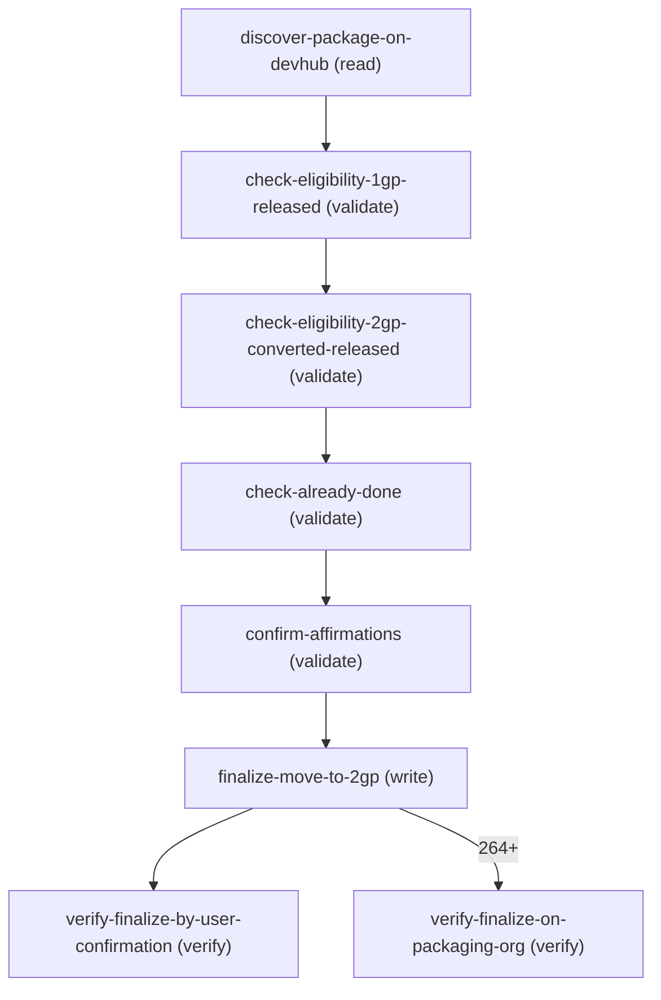

# Move to 2GP Operations Reference

Operations grouped by purpose. Use these as the building blocks for the workflows above.

**Running the reads:** Package2, Package2Version, MetadataPackage, MetadataPackageVersion and PackageConversion are Tooling API objects. The standard API returns `INVALID_TYPE` for them, so every read below uses `sf data query --use-tooling-api`. Run each **Command** as shown: pass aliases single-quoted, and substitute only Ids that already passed their validation pattern.

**Id checks:** an Id is valid if it is exactly 15 or 18 letters and digits and starts with its prefix. Count the characters with a tool when one is available rather than by eye, and give one final verdict. Never say a value is invalid and then correct yourself in the same answer.

### Summary

| Operation | Purpose | Status | Call | Depends on |
|-----------|---------|--------|------|------------|
| `discover-package-on-devhub` | read | implemented | `queryPackage2ByConvertedFrom` | — |
| `check-eligibility-1gp-released` | validate | implemented | `queryHighestReleased1GPVersion` | `discover-package-on-devhub` |
| `check-eligibility-2gp-converted-released` | validate | implemented | `queryReleased2GPConvertedVersion` | `check-eligibility-1gp-released` |
| `check-already-done` | validate | implemented | `queryNativePackage2Version` | `check-eligibility-2gp-converted-released` |
| `confirm-affirmations` | validate | implemented | — | `check-already-done` |
| `finalize-move-to-2gp` | write | implemented | `finalizeMoveTo2gp` | `confirm-affirmations` |
| `verify-finalize-by-user-confirmation` | verify | implemented | — | `finalize-move-to-2gp` |
| `verify-finalize-on-packaging-org` | verify | implemented | `queryPackageConversion` | `finalize-move-to-2gp` (264 and later only) |

### Dependency graph

### Read operations

#### `discover-package-on-devhub`

Look up the 2GP Package2 record on DevHub for the 1GP package the user wants to move. The user provides the 1GP package by name (the customer-facing label) or by SubscriberPackageId (the 033... key prefix). Returns the Package2 Id (0Ho... key prefix), namespace prefix, and ContainerOptions of the converted Package2, plus its ConvertedFromPackageId (the 1GP 033 Id) for use in eligibility queries. This is the DevHub-side anchor for the DevHub-side eligibility checks; the 1GP-side eligibility check uses the 1GP package's 033 Id (the MetadataPackage Id on the 1GP DE org) directly.

**Lookup key:** find the converted Package2 with `SELECT Id, Name, NamespacePrefix, ConvertedFromPackageId, ContainerOptions FROM Package2 WHERE ConvertedFromPackageId = '<1GP 033 Id>'`. Do NOT query `Package2 WHERE SubscriberPackageId = '<1GP 033 Id>'` — a converted Package2 has its own, different SubscriberPackageId (a new 033 Id), so that query returns 0 rows for a correctly converted package. The 1GP 033 Id only appears on the converted Package2 as `ConvertedFromPackageId`.

**Call:** `queryPackage2ByConvertedFrom`   — status: `implemented`

**Inputs:**

- `devhub_alias` *(`String`)* — Source: user_input. The `sf` alias of the user's DevHub org. Captured at skill start (see agent_guidance "AT START").
  - **Use exactly as given:** use the alias exactly as the customer gave it, and pass it as a single-quoted shell argument (never inside double quotes, where `$(...)` and backticks still run). If it contains a newline, `;`, `|`, `&`, `$`, or a backtick, it looks like it carries an extra command. Ask the customer to confirm or re-enter it. Never trim, split, or otherwise alter it; for example, `pkgA; sf org list` is not shortened to `pkgA`.
- `subscriber_package_id` *(`String`)* — The 1GP package's SubscriberPackageId (033... key prefix). User provides this directly, or agent obtains it via a MetadataPackage name lookup on the 1GP DE org (see agent_guidance). Validate it against the `validation` pattern before substituting it into any query or URL path; if it does not match, stop and ask the user for the correct Id.
  - **Validation:** Must match `/^033[A-Za-z0-9]{12}([A-Za-z0-9]{3})?$/` (a 15- or 18-character 033-prefix Id). Reject any value containing single quotes, backslashes, or whitespace.
  - **Validate exactly as given:** apply the pattern to the whole value the user supplied. Never trim, split, extract a matching substring, or otherwise rewrite it to make it pass. For example, `033xx0000004Fpd ; sf org list` does NOT match and must be rejected — do not keep the `033xx0000004Fpd` prefix. On any mismatch, stop and ask the user to re-enter just the Id.

**Command:** `sf data query --use-tooling-api --target-org '<devhub_alias>' --query "SELECT Id, Name, NamespacePrefix, ConvertedFromPackageId, ContainerOptions FROM Package2 WHERE ConvertedFromPackageId = '<1GP 033 Id>'" --json`

**Name lookup:** if the user only knows the package name, run `sf data query --use-tooling-api --target-org '<packaging_org_alias>' --query "SELECT Id, Name, NamespacePrefix FROM MetadataPackage" --json` on the 1GP DE org and filter the results client-side by Name. Do not interpolate user input into SOQL literals. The MetadataPackage `Id` is the 1GP 033 Id this step needs; validate it against the `validation` pattern before using it. If multiple packages match, list them and ask the user to pick by NamespacePrefix.

**Validate returned values before reuse:** before substituting any value returned by this step or by `check-eligibility-1gp-released` into a later query, confirm `package2_id` matches `/^0Ho[A-Za-z0-9]{12}([A-Za-z0-9]{3})?$/` and that `MajorVersion` / `MinorVersion` are non-negative integers. If any value fails, stop — do not substitute it.

**Interpreting the result:** if the Package2 query returns 0 rows, the 1GP package has not been converted to 2GP yet. Stop and tell the user: "I can't find a 2GP-converted Package2 record for your 1GP package on this DevHub. The package needs to be converted to 2GP before Move-to-2GP can complete. See the [Move to 2GP workflow documentation](https://developer.salesforce.com/docs/atlas.en-us.pkg1_dev.meta/pkg1_dev/migration_move_to_2gp_workflow.htm) for the conversion process." Before concluding that, confirm the query used `ConvertedFromPackageId` (not `SubscriberPackageId`) and the correct DevHub alias.

### Write operations

#### `finalize-move-to-2gp`

Irrevocably finalize the Move-to-2GP transition by POSTing to the packaging Connect API endpoint `POST /services/data/v69.0/connect/packaging/package/{packageId}/finalize-move-to-2gp` against the 1GP DE (packaging) org. `{packageId}` is the 1GP MetadataPackage Id (033- prefix). The request body carries the three affirmation flags — acknowledgedIrrevocable, acknowledgedTestingComplete, acknowledgedSourceRetrieved — all required and all must be true (these are exactly what the user confirmed in confirm-affirmations). Server-side the endpoint enforces the CreatePackaging edit-access gate, re-validates the three affirmations, confirms the URL packageId matches the org's in-progress conversion, then finalizes it — after which PackageConversion.EndDate is set. Shipped in 266 (operationId finalizeMoveTo2gp, MCP-enabled). On success returns successfullyFinalized, finalizedAt, packageId, and conversionId. For orgs on a pre-266 release, fall back to the manual browser path (invocation.fallback) which delivers the user to viewAllPackage.apexp to click "Move to 2GP" → Proceed.

**Call:** `finalizeMoveTo2gp`   — status: `implemented`

**Inputs:**

- `packaging_org_alias` *(`String`)* — Source - output of confirm-affirmations (transitively from check-eligibility-1gp-released.packaging_org_alias). The `sf` alias of the user's 1GP DE (packaging) org.
  - **Source:** output of `check-eligibility-1gp-released`
- `subscriber_package_id` *(`String`)* — Source - output of confirm-affirmations (transitively from discover-package-on-devhub.subscriber_package_id). The 1GP MetadataPackage's SubscriberPackageId / 033- prefix.
  - **Source:** output of `discover-package-on-devhub`
- `acknowledged_irrevocable` *(`Boolean`)* — Source - output of confirm-affirmations (acknowledged_irrevocable).
- `acknowledged_testing_complete` *(`Boolean`)* — Source - output of confirm-affirmations (acknowledged_testing_complete).
- `acknowledged_source_retrieved` *(`Boolean`)* — Source - output of confirm-affirmations (acknowledged_source_retrieved).

**Depends on:** `confirm-affirmations`

**Command** (run it only when all four questions in `confirm-affirmations` were confirmed, so each bound flag below is genuinely true; otherwise don't run it): `sf api request rest '/services/data/v69.0/connect/packaging/package/<1GP 033 Id>/finalize-move-to-2gp' --method POST --body '{"acknowledgedIrrevocable": true, "acknowledgedTestingComplete": true, "acknowledgedSourceRetrieved": true}' --target-org '<packaging_org_alias>'`

**Before dispatching:** dispatch the POST directly; do not open a browser tab in the normal path. Don't POST when the release is already known to be before 266 (`INVALID_TYPE` on the PackageConversion query, or an earlier 404 from this endpoint after a PackageConversion row); use the pre-266 fallback. Dispatch only when the eligibility gate passed and every affirmation in `confirm-affirmations` was individually confirmed by the user. Bind each body flag to the value the user confirmed (acknowledgedIrrevocable ← acknowledged_irrevocable, acknowledgedTestingComplete ← acknowledged_testing_complete, acknowledgedSourceRetrieved ← acknowledged_source_retrieved). Never hard-code them true. If any flag was not genuinely confirmed, STOP and do not dispatch — never attest on the user's behalf. The endpoint's own 400 on a false flag is a backstop, not a substitute for per-flag confirmation. `target_org` is the 1GP DE (packaging) org alias.

**Interpreting the response:**

- **200 with `successfullyFinalized=true`** — the move is done. Capture `finalizedAt` and `conversionId`, then run `verify-finalize-on-packaging-org`. Remind the user: "Your next step is to run `sf package version create` from your DX project to create your first native 2GP version."
- **400 `INVALID_INPUT`** — the request was rejected. Business-rule 400s use the error code `INVALID_INPUT`; tell the causes apart by the meaning of the message (it is localized, so don't match exact wording), and surface it verbatim. Common causes:
  - An affirmation flag is missing or false — re-run `confirm-affirmations`.
  - The URL packageId doesn't match the package being converted for this org — wrong package or wrong packaging org; re-check the discover output.
  - "Package has already been moved to 2GP" — the move already happened. Run `verify-finalize-on-packaging-org`; if EndDate is set, report the move as done (an early-exit success, not an error). `check-already-done` should have caught this before the questions.
  - "you must first convert and release the highest released version" — a newer 1GP version has no released converted 2GP equivalent. `check-eligibility-2gp-converted-released` should have caught this; flag that the eligibility query may need review.
  - "Cannot finalize: ... has active released patch versions" — the highest released 1GP version is a patch. Same remediation as "A patch is not eligible" in `check-eligibility-1gp-released`: create the next major or minor 1GP version, convert it, promote it, then retry.
  - "Cannot finalize: An active patch org exists" — tell the user what the message asks them to do.
- **403** — the caller lacks CreatePackaging edit access (or dev-org ownership), the feature is disabled org-wide, or the packageId does not exist (the access gate reports a missing package as 403, not 404). Confirm the user has CreatePackaging and is authenticated to the correct 1GP DE org.
- **404** — the package is editable but the org has no PackageConversion record; the package was never converted to 2GP. Route the user to run the conversion process first. Exception: if the PackageConversion query already returned a row for this package, a 404 means the endpoint itself is unavailable (org on release 264-265); use the pre-266 fallback instead.
- **400 `REQUIRED_FIELD_MISSING` or `INVALID_TYPE`** — the agent built the request wrong (missing packageId or body, or a wrong body type). Fix the request; don't re-ask the user.
- **500 `INTERNAL_ERROR`** — first run `verify-finalize-on-packaging-org`; if EndDate is set, the move is done. Otherwise, for "We couldn't verify the package", retry once; for any other 500, surface the message with its reference ID and point the user to Salesforce Partner Support.

**Pre-266 fallback:** use it only if the endpoint is unavailable (org on a release before 266). Open the fallback Setup path in the browser, walk the user through clicking Move to 2GP → Proceed, wait for their "done", then run `verify-finalize-by-user-confirmation`, followed by `verify-finalize-on-packaging-org` on release 264-265 only. To tell the release: `INVALID_TYPE` on the PackageConversion query, run with `--use-tooling-api`, means before 264; a PackageConversion row plus a 404 from the finalize endpoint means 264-265. The same rule applies: do not direct the user to click Proceed until every affirmation in `confirm-affirmations` is individually confirmed.

### Verify operations

#### `verify-finalize-by-user-confirmation`

Human cross-check for the pre-266 manual fallback path ONLY: ask the user what the Setup page showed after they clicked Proceed. This step applies only when finalize-move-to-2gp took its manual browser fallback (org on a pre-266 release). In the normal 266 path the agent dispatches the finalize directly and the user never interacts with a browser, so this step is skipped — the endpoint's own response (successfullyFinalized / finalizedAt / conversionId) plus verify-finalize-on-packaging-org's EndDate wire-verify are the authoritative signals. Retained because the fallback still needs a verification surface when no direct-dispatch response exists.

**Status:** `implemented`

**Inputs:**

- `package_name` *(`String`)* — Source - output of finalize-move-to-2gp (transitively from discover-package-on-devhub.package_name).
  - **Source:** output of `discover-package-on-devhub`

**Depends on:** `finalize-move-to-2gp`

**Interpreting the user's report (fallback path only):**

- **Success** — the user reports a success message and that the Move to 2GP button is gone. Report success with the package name and remind them to run `sf package version create` for their first native 2GP version of <package_name>.
- **Ambiguous** — the page didn't visibly change or the user isn't sure. Ask them to return to the package detail page and check whether the Move to 2GP button is still visible. If it is, finalize did NOT happen — walk them through it again. On 264+ orgs, `verify-finalize-on-packaging-org` gives the authoritative answer: EndDate populated means success regardless of the button.
- **Error** — capture the message verbatim and point the user to Salesforce Support; do not speculate about the internal cause. Common dialog causes: feature disabled org-wide, or an eligibility failure (a 1GP version newer than its converted 2GP equivalent).

#### `verify-finalize-on-packaging-org`

The canonical wire-verification: re-query the PackageConversion record on the 1GP DE org to confirm EndDate is populated (non-null). EndDate is set by the package-conversion finalization service as part of finalize and is the reliable post-finalize wire signal. Uses the read-only PackageConversion Tooling exposure shipped in 264, so it applies only to orgs on release 264 or later. This is the canonical wire-verify and runs directly after finalize-move-to-2gp; on the pre-266 manual fallback it follows the user attestation in verify-finalize-by-user-confirmation on release 264-265 only. Before 264 the user's report is the only verification. Note: the finalize step's own 266 response also returns finalizedAt + conversionId directly, so this step is a durable cross-check rather than the sole success signal.

**Call:** `queryPackageConversion`   — status: `implemented`

**Inputs:**

- `packaging_org_alias` *(`String`)* — Source - output of finalize-move-to-2gp (transitively from check-eligibility-1gp-released.packaging_org_alias).
  - **Source:** output of `check-eligibility-1gp-released`
- `subscriber_package_id` *(`String`)* — Source - output of finalize-move-to-2gp (transitively from discover-package-on-devhub.subscriber_package_id).
  - **Source:** output of `discover-package-on-devhub`

**Depends on:** `finalize-move-to-2gp`

**Command:** `sf data query --use-tooling-api --target-org '<packaging_org_alias>' --query "SELECT Id, EndDate, FinalizedVersionId, FinalizedVersionNumber FROM PackageConversion WHERE ConvertedFromPackageId = '<1GP 033 Id>'" --json`

**Also runs before the affirmations (264 and later):** the same query runs from `check-already-done`, before `confirm-affirmations`, using `packaging_org_alias` from `check-eligibility-1gp-released` and `subscriber_package_id` from `discover-package-on-devhub`.

**Notes:** 264 shipped the read-only public Tooling exposure of PackageConversion (available when packaging is enabled for the org). The fields queried here — Id, EndDate, FinalizedVersionId (FK → SubscriberPackageVersion), FinalizedVersionNumber, and the WHERE key ConvertedFromPackageId (FK → SubscriberPackage) — are all exposed read-only. EndDate non-null means finalize completed. Move-to-2GP does NOT auto-create native Package2Version records on DevHub (native creation is a separate user-driven step), so there is no Package2Version-based wire-verify; EndDate is the reliable signal.

**Interpreting the result:** EndDate populated → finalize completed; report success. EndDate still null after a successful finalize response (or a reported success on the fallback) → surface it as an anomaly. Possible causes: (a) finalize reported success but did not persist (report to Salesforce Support); (b) brief eventual-consistency lag (retry once after 30s); (c) the finalize ran against a different 1GP DE org than the one queried here (check that `packaging_org_alias` is the alias used for the POST). The finalize response's `finalizedAt` / `conversionId` are authoritative for that call.

### Other operations

#### `check-eligibility-1gp-released`

Find the highest Released 1GP version (major.minor.patch, then build) of the package by querying MetadataPackageVersion on the 1GP DE org. MetadataPackageVersion is the 1GP DE-side view of `all_package_version` joined with `dev_package_version`, with a `ReleaseState` STATICENUM field whose Released picklist value is `"Released"`.

**Call:** `queryHighestReleased1GPVersion`   — status: `implemented`

**Inputs:**

- `packaging_org_alias` *(`String`)* — Source: user_input. The `sf` alias of the user's 1GP DE (packaging) org. Captured at skill start (see agent_guidance "AT START").
  - **Use exactly as given:** same rule as `devhub_alias` in `discover-package-on-devhub`. Never trim, split, or otherwise alter it.
- `subscriber_package_id` *(`String`)* — Source - output of discover-package-on-devhub. This is the 1GP package's 033 Id (the MetadataPackage Id on the 1GP DE org), which discover-package-on-devhub matched against `Package2.ConvertedFromPackageId`. It is NOT the converted Package2's own SubscriberPackageId, which is a different 033 Id.

**Depends on:** `discover-package-on-devhub`

**Command:** `sf data query --use-tooling-api --target-org '<packaging_org_alias>' --query "SELECT Id, MajorVersion, MinorVersion, PatchVersion, ReleaseState FROM MetadataPackageVersion WHERE MetadataPackageId = '<1GP 033 Id>' AND ReleaseState = 'Released' ORDER BY MajorVersion DESC, MinorVersion DESC, PatchVersion DESC, BuildNumber DESC LIMIT 1" --json`

**Interpreting the result:** 0 rows means the package has no Released 1GP versions, so Move-to-2GP cannot proceed. Tell the user: "Your 1GP package has no Released versions on the packaging org. You need at least one Released 1GP version (whose 2GP conversion is also Released) before you can Move to 2GP." Otherwise capture `MajorVersion`, `MinorVersion` and `PatchVersion` as the target X.Y.Z for the next step, after checking all three are non-negative integers (see `discover-package-on-devhub`). The query orders by patch and build too, so this is the same highest Released version the finalize endpoint uses.

**A patch is not eligible:** if `PatchVersion` is greater than 0, the highest Released 1GP version is a patch (for example 1.4.1), and the endpoint rejects finalize for it, even if a converted 1.4.0 is Released. Never say eligibility is judged on major.minor only. Tell the user: "Your highest Released 1GP version, X.Y.Z, is a patch version, and Move-to-2GP can't be finalized at a patch. Create the next major or minor 1GP version, convert it, promote the converted version to Released, then try again." Do not ask the affirmation questions.

#### `check-eligibility-2gp-converted-released`

Confirm a 2GP-converted Package2Version exists at the same major.minor.patch as the highest Released 1GP version, AND that the 2GP version is Released. This is the second half of the eligibility gate — Move-to-2GP requires the highest Released 1GP version to have a RELEASED 2GP-converted equivalent at the same major.minor.patch. Queries Package2Version on DevHub.

**Call:** `queryReleased2GPConvertedVersion`   — status: `implemented`

**Inputs:**

- `devhub_alias` *(`String`)* — Source - output of check-eligibility-1gp-released (transitively from discover-package-on-devhub.devhub_alias).
  - **Source:** output of `discover-package-on-devhub`
- `package2_id` *(`String`)* — Source - output of check-eligibility-1gp-released (transitively from discover-package-on-devhub.package2_id).
  - **Source:** output of `discover-package-on-devhub`
- `major` *(`Integer`)* — Source - output of check-eligibility-1gp-released (highest_1gp_major).
- `minor` *(`Integer`)* — Source - output of check-eligibility-1gp-released (highest_1gp_minor).

**Depends on:** `check-eligibility-1gp-released`

**Command:** `sf data query --use-tooling-api --target-org '<devhub_alias>' --query "SELECT Id, SubscriberPackageVersionId, MajorVersion, MinorVersion, PatchVersion, IsReleased, ConvertedFromVersionId, HasPassedCodeCoverageCheck FROM Package2Version WHERE Package2Id = '<0Ho>' AND MajorVersion = <X> AND MinorVersion = <Y> AND ConvertedFromVersionId != NULL ORDER BY PatchVersion DESC, BuildNumber DESC" --json`

**Interpreting the result:** the query returns every converted version at X.Y, Released or not, so one read tells the cases apart. Before using any returned value, check `Id` matches `/^05i[A-Za-z0-9]{12}([A-Za-z0-9]{3})?$/`, `SubscriberPackageVersionId` matches `/^04t[A-Za-z0-9]{12}([A-Za-z0-9]{3})?$/`, and `PatchVersion` is a non-negative integer; stop if any fails.

The user is **eligible** only if a row has `IsReleased = true` and the same `PatchVersion` as the highest Released 1GP version. The endpoint compares the full major.minor.patch, not just major.minor. Otherwise the user is BLOCKED. Tell them which case applies, and don't ask the affirmation questions:

- **0 rows:** "I see your highest Released 1GP version is X.Y.Z, but no 2GP-converted version exists at X.Y. You need to convert X.Y.Z before Move-to-2GP can complete."
- **Rows exist, but none is Released at patch Z:** the converted X.Y.Z must be promoted to Released. Use the first row with `PatchVersion` = Z (the latest build).
  - If its `HasPassedCodeCoverageCheck` is not true, it can't be promoted. The user must convert X.Y.Z again with code coverage (the `dx-packaging-convert-1gp-to-2gp-create` skill).
  - If it is true, promotion uses the row's 04t `SubscriberPackageVersionId`, never the 05i `Id`, which `sf package version promote` rejects: `sf package version promote --package '<04t>' --target-dev-hub '<devhub_alias>' --no-prompt`.
  - Promotion to Released is also irreversible, so it's a separate decision. Show the command and ask whether to promote as its own question. Never run it as part of the move, and never infer consent from the move request. After any promotion, run this check again.

Do not proceed to `confirm-affirmations` until this step finds the Released converted X.Y.Z.

**Server-only check:** the endpoint also refuses to finalize while an active patch org exists for X.Y without an uploaded patch. No public query shows this, so passing these checks doesn't guarantee finalize succeeds. If the finalize 400 says an active patch org exists, relay what the message asks the user to do.

#### `check-already-done`

Detect the early-exit case — if a native (non-converted) Package2Version exists for this Package2, Move-to-2GP has ALREADY happened OR the package was 2GP-native to start with. Native 2GP versions are characterized by ConvertedFromVersionId = NULL. If any such Package2Version exists, the skill exits immediately.

**Also check the packaging org:** a finalize does not create a native Package2Version, so a package that was finalized but has no native version yet passes the query above.

**Before 264:** the PackageConversion query fails with `INVALID_TYPE`, because the object doesn't exist on these releases. Leaving off `--use-tooling-api` gives the same error, so this counts only when the query was run with `--use-tooling-api` exactly as shown; otherwise fix the command. This is the only case where you skip the query instead of fixing it. Rely on the native-version check above (needs DevHub) and on the Setup page: before any affirmation, ask the user, as one question, whether the Move to 2GP button is still shown on the package detail page. If it isn't, the move is done.

**264 and later:** before `confirm-affirmations`, also run the `verify-finalize-on-packaging-org` query (`SELECT Id, EndDate, FinalizedVersionId, FinalizedVersionNumber FROM PackageConversion WHERE ConvertedFromPackageId = '<1GP 033 Id>'`) against `packaging_org_alias`, using the Tooling API (for example `sf data query --use-tooling-api`). Run it whether or not DevHub is available. If `EndDate` is set, the move is already done: report it, with `FinalizedVersionNumber`, and stop. Do not ask the affirmation questions. If it returns 0 rows, the org has no conversion record for this package (not converted yet, or wrong packaging org): stop before the questions and route the user to the conversion process. On 264 and later, if the query fails, fix the command; don't skip the check.

| Release | Finalize | Verify |
|---|---|---|
| Before 264 | Browser flow in Setup | The user's report of the Setup page (`verify-finalize-by-user-confirmation`) |
| 264–265 | Browser flow in Setup | The user's report, then `PackageConversion.EndDate` (`verify-finalize-on-packaging-org`) |
| 266 and later | Connect API `finalize-move-to-2gp` | `PackageConversion.EndDate` (`verify-finalize-on-packaging-org`) |

**Command:** `sf data query --use-tooling-api --target-org '<devhub_alias>' --query "SELECT Id, MajorVersion, MinorVersion, IsReleased FROM Package2Version WHERE Package2Id = '<0Ho>' AND ConvertedFromVersionId = NULL LIMIT 1" --json`

**Call:** `queryNativePackage2Version`   — status: `implemented`

**Inputs:**

- `devhub_alias` *(`String`)* — Source - output of check-eligibility-2gp-converted-released (transitively from discover-package-on-devhub.devhub_alias).
  - **Source:** output of `discover-package-on-devhub`
- `package2_id` *(`String`)* — Source - output of check-eligibility-2gp-converted-released (transitively from discover-package-on-devhub.package2_id).
  - **Source:** output of `discover-package-on-devhub`

**Depends on:** `check-eligibility-2gp-converted-released`

**Interpreting the result:** 1 or more native rows, or a PackageConversion `EndDate` that is set, means EARLY EXIT. Either the move already happened (ConvertedFromPackageId was non-null at discovery) or the package was 2GP-native from the start. ContainerOptions can't tell these apart; both are `Managed`. Either way, tell the user: "Move-to-2GP has already been completed for this package — no further action needed." Proceed to `confirm-affirmations` only if 0 native rows return AND, on 264 and later, `EndDate` is null; before 264, only if the Move to 2GP button is still on the package detail page.

#### `confirm-affirmations`

Present the irrevocability + testing affirmations to the user, mirroring the "Move to Second-Generation Managed Packaging" dialog shown in Setup UI. The user must explicitly confirm each affirmation before the agent proceeds to the finalize step. This step has no API surface — it's a structured agent-to-user interaction whose answers become the request-body flags of `finalize-move-to-2gp` (and gate the pre-266 manual flow).

**Status:** `implemented`

**Inputs:**

- `package_name` *(`String`)* — Source - output of check-already-done (transitively from discover-package-on-devhub.package_name).
  - **Source:** output of `discover-package-on-devhub`
- `package2_id` *(`String`)* — Source - output of check-already-done (transitively from discover-package-on-devhub.package2_id).
  - **Source:** output of `discover-package-on-devhub`

**Depends on:** `check-already-done`

**Ask four separate questions, one at a time, and wait for an answer to each:**

1. **Irreversibility** — "Moving to 2GP development is IRREVERSIBLE. After this step, you can no longer create new major or minor 1GP versions of this package — neither via `sf package1 version create` nor via the upload flow on viewAllPackage.apexp. All future development must use 2GP via `sf package version create`. Confirm you understand this is a one-way transition."
2. **Conversion testing** — "Have you completed package conversion testing for this package?"
3. **Subscriber migration testing** — "Have you completed subscriber migration testing (migrating a test subscriber org from the 1GP package to the converted 2GP package)?"
4. **Source retrieved** — "Have you run `sf package version retrieve --package <04t...> --output-dir <folder> --target-dev-hub <devhub>` and updated `versionName`, `versionNumber`, and `ancestorVersion` in sfdx-project.json?" If the user says retrieve failed with `DeveloperUsePkgZipFieldUnavailableError`, their DevHub user needs the **Download Package Version Zip Files** user permission (for example through a permission set their admin assigns). They retry after it's granted; the answer stays no until then.

This is the same order as the Setup dialog: irreversibility, then testing, then source. Question 1 sets `acknowledged_irrevocable`. Questions 2 and 3 are different tests: ask them separately and never merge them into one question. `acknowledged_testing_complete` is true only if the user confirmed BOTH. Question 4 sets `acknowledged_source_retrieved`.

**What counts as a confirmation:** each answer applies only to the question it replies to. A single bare "yes", "ok", "yes to all", or "I confirm everything" never confirms more than one question. If the user answers that way to several questions at once, re-ask each unconfirmed question individually. An answer the user gave before you asked a question doesn't confirm it either.

**If any answer is no or unclear:** STOP. Do not call `finalize-move-to-2gp` and do not direct the user to click Proceed. Tell them what is blocked and what to do first (run conversion tests, run subscriber migration tests, or run `sf package version retrieve`).

**Patch follow-up:** the irreversibility question does not mention patches; don't add that caveat to it. If the user asks whether they can still cut a patch, answer exactly: 1GP patch versions stay permitted only for major.minor versions *lower* than the finalized version, so unmigrated 1GP subscribers on those versions can still get hotfixes. Patches for the finalized major.minor itself must be built in 2GP. For example, after finalizing at 1.4.0, a 1GP 1.3.x patch is allowed, but a 1GP 1.4.x patch is not.
