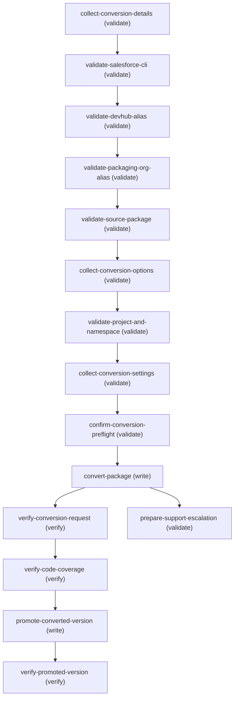

# Convert 1GP to 2GP Operations Reference

Operations grouped by purpose. Use these as the building blocks for the workflow in SKILL.md.

## Summary

| Operation | Purpose | Status | Call | Depends on |
|-----------|---------|--------|------|------------|
| `collect-conversion-details` | validate | implemented | — | — |
| `validate-salesforce-cli` | validate | implemented | — | `collect-conversion-details` |
| `validate-devhub-alias` | validate | implemented | — | `validate-salesforce-cli` |
| `validate-packaging-org-alias` | validate | implemented | — | `validate-devhub-alias` |
| `validate-source-package` | validate | implemented | — | `validate-packaging-org-alias` |
| `collect-conversion-options` | validate | implemented | — | `validate-source-package` |
| `validate-project-and-namespace` | validate | implemented | — | `collect-conversion-options` |
| `collect-conversion-settings` | validate | implemented | — | `validate-project-and-namespace` |
| `confirm-conversion-preflight` | validate | implemented | — | `collect-conversion-settings` |
| `convert-package` | write | implemented | — | `confirm-conversion-preflight` |
| `verify-conversion-request` | verify | implemented | — | `convert-package` |
| `verify-code-coverage` | verify | implemented | — | `verify-conversion-request` |
| `promote-converted-version` | write | implemented | — | `verify-code-coverage` |
| `verify-promoted-version` | verify | implemented | — | `promote-converted-version` |
| `prepare-support-escalation` | validate | implemented | — | `convert-package` |

## Dependency graph

## Write operations

### `convert-package`

Run the official Salesforce CLI package conversion from the validated DX project. Always include `--code-coverage`, the validated 033 package ID and Dev Hub alias, one installation-protection flag, and a wait duration. Salesforce CLI selects the latest released major.minor version unless the customer supplies `--patch-version major.minor.patch`. Add `--definition-file` and `--seed-metadata` only when required. Unpackaged metadata for packaged Apex tests has no flag; Salesforce CLI applies the confirmed `unpackagedMetadata` setting from sfdx-project.json.

**Status:** `implemented`

**Inputs:**

- `package_id` *(`String`)* — Validated managed 1GP package ID beginning with 033.
- `devhub_alias` *(`String`)* — Validated Dev Hub alias.
- `wait_minutes` *(`Integer`)* — Minutes for Salesforce CLI to wait before returning an in-progress request.
- `patch_version` *(`String`)* — Optional released major.minor.patch value.
- `definition_file` *(`String`)* — Source - output of collect-conversion-settings; the displayed project definition-file path only when the customer confirmed it is required.
- `seed_metadata_directory` *(`String`)* — Source - output of collect-conversion-settings; populated only after the customer confirmed seed metadata exists and supplied a validated directory path.

**Depends on:** `confirm-conversion-preflight`

**Rollback:** none. Package conversion does not alter the original 1GP package, but the association between this package and the selected Dev Hub cannot be transferred or changed. Do not attempt automatic cleanup or reassignment.

### `promote-converted-version`

After code coverage passes and the customer explicitly says yes to the promotion question, promote the verified converted subscriber package version from beta to released. Never promote a different 04t and never infer consent from the original conversion request.

**Status:** `implemented`

**Inputs:**

- `subscriber_package_version_id` *(`String`)* — Source - output of verify-code-coverage; converted 04t whose coverage check passed.
- `devhub_alias` *(`String`)* — Validated Dev Hub alias used for conversion.
- `promotion_confirmed` *(`Boolean`)* — True only when the customer explicitly answered yes to the promotion question after conversion succeeded.

**Depends on:** `verify-code-coverage`

**Rollback:** none. Package-version promotion to Released is irreversible.

## Verify operations

### `verify-conversion-request`

Retrieve the Package2VersionCreateRequest identified by the 08c conversion request ID. Confirm it reached Success and returned the Package2, Package2Version, SubscriberPackageVersion, and converted-from identifiers. If the request is still pending, repeat this same report command approximately every two minutes, give the customer a status update after each report, and never start another conversion.

**Status:** `implemented`

**Inputs:**

- `request_id` *(`String`)* — Package version creation request ID beginning with 08c.
- `devhub_alias` *(`String`)* — Validated Dev Hub alias.

**Depends on:** `convert-package`

### `verify-code-coverage`

Retrieve the converted subscriber package version and verify that code coverage was calculated and passed. HasPassedCodeCoverageCheck must be true for the converted beta version to qualify for promotion. Also confirm ConvertedFromVersionId is populated, proving this is a converted version.

**Status:** `implemented`

**Inputs:**

- `subscriber_package_version_id` *(`String`)* — Converted subscriber package version ID beginning with 04t.
- `devhub_alias` *(`String`)* — Validated Dev Hub alias.

**Depends on:** `verify-conversion-request`

### `verify-promoted-version`

Re-read the promoted subscriber package version and require IsReleased to be true. Then present the complete package details again with the release state shown as Released.

**Status:** `implemented`

**Inputs:**

- `subscriber_package_version_id` *(`String`)* — Source - output of promote-converted-version.
- `devhub_alias` *(`String`)* — Validated Dev Hub alias used for promotion.

**Depends on:** `promote-converted-version`

## Other operations

### `collect-conversion-details`

Collect only the non-secret identity and package inputs needed for initial discovery: Dev Hub alias, 1GP packaging-org alias, 033 package ID, and package namespace. Defer every configurable conversion option until released versions have been queried.

**Status:** `implemented`

### `validate-salesforce-cli`

Silently confirm Salesforce CLI is installed before using it. Do not make the customer confirm the CLI version or narrate this check unless the CLI is missing or a command fails because an update is required.

**Status:** `implemented`

**Depends on:** `collect-conversion-details`

### `validate-devhub-alias`

Resolve the customer-provided Dev Hub alias and display its authenticated org identity. Confirm the alias points to the intended PBO/Dev Hub before package conversion permanently associates the converted package with it.

**Status:** `implemented`

**Inputs:**

- `devhub_alias` *(`String`)* — Dev Hub alias supplied during collect-conversion-details.

**Depends on:** `validate-salesforce-cli`

### `validate-packaging-org-alias`

Resolve the customer-provided 1GP packaging-org alias and display its authenticated org identity. Confirm it is the source packaging org for the 033 package.

**Status:** `implemented`

**Inputs:**

- `packaging_org_alias` *(`String`)* — Packaging-org alias supplied during collect-conversion-details.

**Depends on:** `validate-devhub-alias`

### `validate-source-package`

Query the 1GP packaging org through Salesforce CLI Tooling API to confirm the 033 package has at least one managed-released version and to identify the released versions available for conversion. For the default path, Salesforce CLI converts the latest released major.minor. For patch mode, confirm the requested major.minor.patch appears in this result before conversion.

**Status:** `implemented`

**Inputs:**

- `packaging_org_alias` *(`String`)* — Source - output of validate-packaging-org-alias.
- `package_id` *(`String`)* — Source - output of collect-conversion-details.

**Depends on:** `validate-packaging-org-alias`

### `collect-conversion-options`

After released versions are known, collect the source-version choice and DX-project choice. Ask each option separately. Every option question displays its own default, and `default` applies only to that one question. Never silently reuse a DX project.

**Status:** `implemented`

**Inputs:**

- `released_versions` *(`List<Object>`)* — Source - output of validate-source-package.

**Depends on:** `validate-source-package`

### `validate-project-and-namespace`

Confirm the working directory is a Salesforce DX project and its sfdx-project.json contains the 1GP namespace. When the customer selected a new project, create it with the official Salesforce CLI project-generation command, then update sfdx-project.json before conversion. The namespace must already be linked to the selected Dev Hub.

**Status:** `implemented`

**Inputs:**

- `project_directory` *(`String`)* — Source - output of collect-conversion-options.
- `namespace` *(`String`)* — Source - output of collect-conversion-details; namespace registered by the 1GP package and linked to the Dev Hub.

**Depends on:** `collect-conversion-options`

### `collect-conversion-settings`

After the DX project and its default definition file are available, ask each remaining conversion-setting question separately. Show the actual definition-file path instead of asking the customer to discover it. Ask for a seed-metadata directory only when the customer confirms that seed metadata exists, and for an unpackaged-metadata directory only when the customer confirms that packaged Apex tests need it.

**Status:** `implemented`

**Inputs:**

- `definition_file_path` *(`String`)* — Source - output of validate-project-and-namespace; exact path to the project's default config/project-scratch-def.json.

**Depends on:** `validate-project-and-namespace`

### `confirm-conversion-preflight`

Present the final preflight summary and require explicit confirmation of the permanent Dev Hub association, mandatory code coverage, installation-protection choice, and optional conversion inputs.

**Status:** `implemented`

**Inputs:**

- `devhub_org_id` *(`String`)* — Validated Dev Hub org ID.
- `packaging_org_id` *(`String`)* — Validated 1GP packaging-org ID.
- `package_id` *(`String`)* — Managed 1GP package ID beginning with 033.

**Depends on:** `collect-conversion-settings`

### `prepare-support-escalation`

For an unresolved, internal, or repeatedly failing conversion, assemble a sanitized Partner Support bundle without using internal Salesforce systems. Include complete CLI output and stack traces, exact commands with secrets removed, error identifiers, package and request IDs, both org IDs and instance URLs, CLI version, timestamp with time zone, reproduction steps, relevant project configuration, business impact, and customer expectations.

**Status:** `implemented`

**Inputs:**

- `conversion_errors` *(`List<String>`)* — Sanitized errors from the conversion or request report.

**Depends on:** `convert-package`
