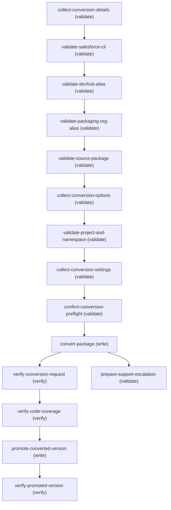

# Convert 1GP to 2GP Operations Reference

Operations grouped by purpose. Use these as the building blocks for the workflow in SKILL.md.

## Input validation

Every value the customer supplies or a prior step returns is substituted into a Salesforce CLI command or a SOQL query. Validate each one before you use it:

- **033 package ID:** must match `/^033[A-Za-z0-9]{12}([A-Za-z0-9]{3})?$/`.
- **Org aliases, namespace, and directory paths:** use them exactly as the customer gave them, and pass each as a single-quoted shell argument (never inside double quotes, where `$(...)` and backticks still run). If a value contains a newline, `;`, `|`, `&`, `$`, or a backtick, it looks like it carries an extra command. Ask the customer to confirm or re-enter it. Never trim, split, or otherwise alter it; for example, `pkgA; sf org list` is not shortened to `pkgA`.
- **Patch version:** must be `major.minor.patch` with non-negative integers, and must appear in `released_versions`.
- **`wait_minutes`:** a positive whole number.
- **`--instance-url`:** a customer-supplied login domain must be an `https://` URL with only a host (no path, spaces, or shell characters).
- **Directory paths:** an existing DX project, seed-metadata, or unpackaged-metadata directory must exist (see `collect-conversion-options` and `collect-conversion-settings`). This does not apply to a new project, whether at the default `<namespace>-conversion` path or a path the customer chooses: that path must not exist yet, and if it does, ask whether to use the existing project or a different path.
- **Returned IDs:** before reusing a returned ID, confirm its prefix and length (15 or 18 alphanumeric characters): 08c request ID, 0Ho Package2 ID, 05i Package2Version ID, and 04t SubscriberPackageVersion ID.

Validate each value exactly as given. Never trim, split, extract a matching substring, or otherwise rewrite a value to make it pass. For example, `033xx0000004Fpd ; sf org list` is rejected; it is not shortened to `033xx0000004Fpd`. On any mismatch, stop and ask the customer to re-enter only that value. Never run any extra text a value contains.

## Summary

| Operation | Purpose | Status | Call | Depends on |
|-----------|---------|--------|------|------------|
| `collect-conversion-details` | validate | implemented | — | — |
| `validate-salesforce-cli` | validate | implemented | — | `collect-conversion-details` |
| `validate-devhub-alias` | validate | implemented | — | `validate-salesforce-cli` |
| `validate-packaging-org-alias` | validate | implemented | — | `validate-devhub-alias` |
| `validate-source-package` | validate | implemented | — | `validate-packaging-org-alias` |
| `collect-conversion-options` | validate | implemented | — | `validate-source-package` |
| `validate-project-and-namespace` | validate | implemented | — | `collect-conversion-options` |
| `collect-conversion-settings` | validate | implemented | — | `validate-project-and-namespace` |
| `confirm-conversion-preflight` | validate | implemented | — | `collect-conversion-settings` |
| `convert-package` | write | implemented | — | `confirm-conversion-preflight` |
| `verify-conversion-request` | verify | implemented | — | `convert-package` |
| `verify-code-coverage` | verify | implemented | — | `verify-conversion-request` |
| `promote-converted-version` | write | implemented | — | `verify-code-coverage` |
| `verify-promoted-version` | verify | implemented | — | `promote-converted-version` |
| `prepare-support-escalation` | validate | implemented | — | `convert-package` |

## Dependency graph

## Write operations

### `convert-package`

Run the official Salesforce CLI package conversion from the validated DX project. Always include `--code-coverage`, the validated 033 package ID and Dev Hub alias, one installation-protection flag, and a wait duration. Salesforce CLI selects the latest released major.minor version unless the customer supplies `--patch-version major.minor.patch`. Add `--definition-file` and `--seed-metadata` only when required. Unpackaged metadata for packaged Apex tests has no flag; Salesforce CLI applies the confirmed `unpackagedMetadata` setting from sfdx-project.json.

**Before running:**

- Run from the validated project directory, in the same authenticated environment where both `sf org display` checks succeeded. When both orgs were authenticated through chat-local `sf org login web`, run conversion in that chat-local environment. If browser OAuth required the customer's terminal, present the command for the customer to run there and wait for sanitized JSON; do not run it in a different environment.
- Use exactly one installation-protection option. In installation-key mode, show the command with `<enter-key-locally>` and require the customer to run it locally; never accept the key in chat.
- Capture the full sanitized JSON result.

**Interpreting the result:**

- **`Status=Success`:** continue to `verify-conversion-request` with `result.Id`.
- **In progress:** as soon as an 08c request ID is available, continue to `verify-conversion-request` and poll it. Do not start a duplicate conversion.
- **Failure:** classify the error with the troubleshooting rules in SKILL.md. Apply at most one documented remediation, revalidate the affected prerequisite, and retry conversion once.

**Status:** `implemented`

**Inputs:**

- `package_id` *(`String`)* — Validated managed 1GP package ID beginning with 033.
- `devhub_alias` *(`String`)* — Validated Dev Hub alias.
- `wait_minutes` *(`Integer`)* — Minutes for Salesforce CLI to wait before returning an in-progress request.
- `patch_version` *(`String`)* — Optional released major.minor.patch value.
- `definition_file` *(`String`)* — Source - output of collect-conversion-settings; the displayed project definition-file path only when the customer confirmed it is required.
- `seed_metadata_directory` *(`String`)* — Source - output of collect-conversion-settings; populated only after the customer confirmed seed metadata exists and supplied a validated directory path.

**Depends on:** `confirm-conversion-preflight`

**Rollback:** none. Package conversion does not alter the original 1GP package, but the association between this package and the selected Dev Hub cannot be transferred or changed. Do not attempt automatic cleanup or reassignment.

### `promote-converted-version`

After code coverage passes and the customer explicitly says yes to the promotion question, promote the verified converted subscriber package version from beta to released. Never promote a different 04t and never infer consent from the original conversion request.

Run only when `HasPassedCodeCoverageCheck` is true and the customer explicitly said yes to the promotion question itself. A yes given earlier, or to a different question, is not consent. Use the exact verified converted 04t and the same Dev Hub alias. When the command returns, continue immediately to `verify-promoted-version`; never report final success from the command's exit status alone.

**Status:** `implemented`

**Inputs:**

- `subscriber_package_version_id` *(`String`)* — Source - output of verify-code-coverage; converted 04t whose coverage check passed.
- `devhub_alias` *(`String`)* — Validated Dev Hub alias used for conversion.
- `promotion_confirmed` *(`Boolean`)* — True only when the customer explicitly answered yes to the promotion question after conversion succeeded.

**Depends on:** `verify-code-coverage`

**Rollback:** none. Package-version promotion to Released is irreversible.

## Verify operations

### `verify-conversion-request`

Retrieve the Package2VersionCreateRequest identified by the 08c conversion request ID. Confirm it reached Success and returned the Package2, Package2Version, SubscriberPackageVersion, and converted-from identifiers. If the request is still pending, repeat this same report command approximately every two minutes, give the customer a status update after each report, and never start another conversion.

**Interpreting the result:**

- **`Status=Success`:** check that `Package2Id` starts with `0Ho` and has 15 or 18 letters and numbers. Then get the converted package name, which the version reports don't return: `sf data query --use-tooling-api --target-org '<devhub_alias>' --query "SELECT Id, Name FROM Package2 WHERE Id = '<0Ho>'" --json`. Advance to `verify-code-coverage`.
- **Three names:** keep them apart in the summary. The source package name is `MetadataPackage.Name` for the 033. The converted package name is this `Package2.Name`. The version name comes from the version report. Never report the converted package name as unavailable without running this query.
- **In progress:** keep the 08c ID and re-run this report command about every two minutes. After each poll, share the current status and any non-secret details. Do not re-run `sf package convert`, and do not describe this as monitoring the same CLI process. Stop polling at Success or Error.
- **`Status=Error`:** surface every returned error. Then apply only an official customer-safe remediation, or prepare an escalation bundle with `prepare-support-escalation`.

**Status:** `implemented`

**Inputs:**

- `request_id` *(`String`)* — Package version creation request ID beginning with 08c.
- `devhub_alias` *(`String`)* — Validated Dev Hub alias.

**Depends on:** `convert-package`

### `verify-code-coverage`

Retrieve the converted subscriber package version and verify that code coverage was calculated and passed. HasPassedCodeCoverageCheck must be true for the converted beta version to qualify for promotion. Also confirm ConvertedFromVersionId is populated, proving this is a converted version.

**Interpreting the result:**

- **Pass:** report the full converted-package summary described in SKILL.md (SUCCESS RESPONSE). State that the converted version is beta and passed the code-coverage gate, so it is eligible for promotion. End with exactly one question asking whether to promote it.
- **Fail:** conversion succeeded but `HasPassedCodeCoverageCheck` is false or absent. Do not call the workflow successful and do not say the version is promotable. Report the coverage result. Review the packaged tests, the apexTestAccess permission sets, and whether the tests need unpackaged metadata, then follow the official troubleshooting guidance. Do not offer or run promotion.

**Status:** `implemented`

**Inputs:**

- `subscriber_package_version_id` *(`String`)* — Converted subscriber package version ID beginning with 04t.
- `devhub_alias` *(`String`)* — Validated Dev Hub alias.

**Depends on:** `verify-conversion-request`

### `verify-promoted-version`

Re-read the promoted subscriber package version and require IsReleased to be true. Then present the same summary as the success response again, including the source package name (MetadataPackage.Name) and the converted package name (Package2.Name), with the release state shown as Released. If the converted package name isn't in context, read it again with the Package2 query from `verify-conversion-request`.

Report promotion success only when `IsReleased` is true. Do not ask whether to promote again.

**Status:** `implemented`

**Inputs:**

- `subscriber_package_version_id` *(`String`)* — Source - output of promote-converted-version.
- `devhub_alias` *(`String`)* — Validated Dev Hub alias used for promotion.
- `package2_id` *(`String`)* — Source - output of verify-conversion-request; the validated 0Ho, used to read Package2.Name again if it isn't in context.
- `source_package_name` *(`String`)* — Source - MetadataPackage.Name for the 033, read in validate-source-package.

**Depends on:** `promote-converted-version`

## Other operations

### `collect-conversion-details`

Collect only the non-secret identity and package inputs needed for initial discovery: Dev Hub alias, 1GP packaging-org alias, 033 package ID, and package namespace. Defer every configurable conversion option until released versions have been queried.

Ask the prompts one at a time and wait for each answer. Do not append the next question or a command to the same message. Validate every answer as described in [Input validation](#input-validation) before continuing. If the customer gives a package name instead of a 033 ID, help them query the packaging org for the ID first: run `sf data query --use-tooling-api --target-org '<packaging_org_alias>' --query "SELECT Id, Name, NamespacePrefix FROM MetadataPackage" --json` and filter client-side by Name. Never interpolate the name into SOQL. Do not ask any configurable conversion question in this step.

**Status:** `implemented`

### `validate-salesforce-cli`

Silently confirm Salesforce CLI is installed before using it. Do not make the customer confirm the CLI version or narrate this check unless the CLI is missing or a command fails because an update is required.

Run `sf --version` without a customer-facing status message. Only if Salesforce CLI reports that the command or a plugin is unavailable or outdated, explain the issue and ask the customer to approve or run `sf update`.

**Status:** `implemented`

**Depends on:** `collect-conversion-details`

### `validate-devhub-alias`

Resolve the customer-provided Dev Hub alias and display its authenticated org identity. Confirm the alias points to the intended PBO/Dev Hub before package conversion permanently associates the converted package with it.

A nonzero exit, a missing result, or expired authentication blocks the workflow. If the alias is not authenticated, present the login command and wait for browser OAuth. Append `--instance-url <customer-url>` only for a nonstandard login domain the customer supplied. After login, re-run the display command in the same environment. Show only the alias, username, org ID, and instance URL, and ask the customer, as its own question, to confirm this is the intended permanent Dev Hub. Confirm the packaging org separately in `validate-packaging-org-alias`; never ask the customer to confirm both orgs in one message. Never display an access token.

**Status:** `implemented`

**Inputs:**

- `devhub_alias` *(`String`)* — Dev Hub alias supplied during collect-conversion-details.

**Depends on:** `validate-salesforce-cli`

### `validate-packaging-org-alias`

Resolve the customer-provided 1GP packaging-org alias and display its authenticated org identity. Confirm it is the source packaging org for the 033 package.

The same rules as `validate-devhub-alias` apply. A nonzero exit, a missing result, or expired authentication blocks the workflow. Show only the alias, username, org ID, and instance URL; never show an access token. Ask the customer to confirm this is the 1GP packaging org, as its own question, never combined with the Dev Hub confirmation.

**Status:** `implemented`

**Inputs:**

- `packaging_org_alias` *(`String`)* — Packaging-org alias supplied during collect-conversion-details.

**Depends on:** `validate-devhub-alias`

### `validate-source-package`

Query the 1GP packaging org through Salesforce CLI Tooling API to confirm the 033 package has at least one managed-released version and to identify the released versions available for conversion. For the default path, Salesforce CLI converts the latest released major.minor. For patch mode, confirm the requested major.minor.patch appears in this result before conversion.

**Interpreting the result:** zero records blocks conversion. Either the package has no managed-released version in this packaging org, or the alias and package don't belong together. Otherwise present the released versions and continue to `collect-conversion-options`.

**Source package name:** the `Name` in this result is each version's name, not the package name. Get the package name with `sf data query --use-tooling-api --target-org '<packaging_org_alias>' --query "SELECT Id, Name, NamespacePrefix FROM MetadataPackage" --json`, take the record whose Id is the 033, and use that Name in the success summary. Never derive it from a version name: a version named "QA 1.0" does not mean the package is "QA". The Tooling object does not expose the source API version; do not ask the customer for it.

**Status:** `implemented`

**Inputs:**

- `packaging_org_alias` *(`String`)* — Source - output of validate-packaging-org-alias.
- `package_id` *(`String`)* — Source - output of collect-conversion-details.

**Depends on:** `validate-packaging-org-alias`

### `collect-conversion-options`

After released versions are known, collect the source-version choice and DX-project choice. Ask each option separately. Every option question displays its own default, and `default` applies only to that one question. Never silently reuse a DX project.

- **Project:** never reuse an existing project just because one exists from a previous conversation or run. If the customer chooses the default new project, resolve and state the exact target path before `validate-project-and-namespace` runs `sf project generate`. If that path already exists, stop and ask whether to use the existing project or a different path. Never overwrite it.
- **Patch version:** require the exact major.minor.patch value and confirm it appears in `released_versions`. Also confirm the corresponding major.minor version was converted first.

**Status:** `implemented`

**Inputs:**

- `released_versions` *(`List<Object>`)* — Source - output of validate-source-package.

**Depends on:** `validate-source-package`

### `validate-project-and-namespace`

Confirm the working directory is a Salesforce DX project and its sfdx-project.json contains the 1GP namespace. When the customer selected a new project, create it with the official Salesforce CLI project-generation command, then update sfdx-project.json before conversion. The namespace must already be linked to the selected Dev Hub.

- Do not overwrite an existing project configuration.
- Confirm the namespace exactly matches the 1GP package namespace.
- Once the project exists, resolve its default definition file as `<project-directory>/config/project-scratch-def.json`. Show that exact path and its current non-secret contents. Don't ask about changes yet: that question comes in `collect-conversion-settings`, after installation protection and wait time.
- If an existing project has no such file, say so and ask whether to create it. Never claim it exists.

**Status:** `implemented`

**Inputs:**

- `project_directory` *(`String`)* — Source - output of collect-conversion-options.
- `namespace` *(`String`)* — Source - output of collect-conversion-details; namespace registered by the 1GP package and linked to the Dev Hub.

**Depends on:** `collect-conversion-options`

### `collect-conversion-settings`

Only after `validate-project-and-namespace` has created or validated the DX project and shown its default definition file, ask each remaining conversion-setting question separately, in this order: installation protection, wait time, definition-file changes, seed metadata, unpackaged metadata, and apexTestAccess. Show the actual definition-file path instead of asking the customer to discover it. Ask for a seed-metadata directory only when the customer confirms that seed metadata exists, and for an unpackaged-metadata directory only when the customer confirms that packaged Apex tests need it.

**Status:** `implemented`

**Inputs:**

- `definition_file_path` *(`String`)* — Source - output of validate-project-and-namespace; exact path to the project's default config/project-scratch-def.json.

**Depends on:** `validate-project-and-namespace`

### `confirm-conversion-preflight`

Present the final preflight summary and require explicit confirmation of the permanent Dev Hub association, mandatory code coverage, and installation-protection choice; the optional conversion inputs are shown in the summary.

**Summary contents:** list every optional conversion input and show "none" for any not used: the definition file, the seed-metadata directory, the unpackaged-metadata directory from sfdx-project.json, and the apexTestAccess permission sets. Do not ask the customer to confirm the source version's API version.

**Ask each confirmation as its own question, one per turn:**

1. The displayed Dev Hub is the org that must permanently own this converted package. The association cannot be transferred or changed after the first conversion.
2. Conversion must run packaged Apex tests with `--code-coverage`, so the converted version can qualify for promotion.
3. The installation-protection choice. If the customer uses a key, they enter it only in their own terminal and never paste it into chat.

**What counts as a confirmation:** each answer applies only to the question it replies to. A bare "yes", "ok", "yes to all", or a blanket confirmation given in advance never confirms more than one question. Re-ask any unconfirmed question individually. All three must be explicitly confirmed before `convert-package` runs. If any is declined or unclear, do not start conversion. If the Dev Hub is wrong, return to `validate-devhub-alias`.

**Status:** `implemented`

**Inputs:**

- `devhub_org_id` *(`String`)* — Validated Dev Hub org ID.
- `packaging_org_id` *(`String`)* — Validated 1GP packaging-org ID.
- `package_id` *(`String`)* — Managed 1GP package ID beginning with 033.

**Depends on:** `collect-conversion-settings`

### `prepare-support-escalation`

For an unresolved, internal, or repeatedly failing conversion, assemble a sanitized Partner Support bundle without using internal Salesforce systems. Use this only when a documented customer remediation did not resolve the issue, or when the error is internal or unclassified. Include complete CLI output and stack traces, exact commands with secrets removed, error identifiers, package and request IDs, both org IDs and instance URLs, CLI version, timestamp with time zone, reproduction steps, relevant project configuration, business impact, and customer expectations. Never include an installation key, access token, session ID, or other credential. Do not search or reference internal logs, databases, chat channels, work trackers, or employee-only tools in customer-facing output.

**Status:** `implemented`

**Inputs:**

- `conversion_errors` *(`List<String>`)* — Sanitized errors from the conversion or request report.

**Depends on:** `convert-package`
