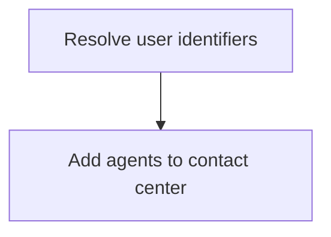

# Add Agents to Contact Center

## When to Use This Skill

Use this skill when a user wants to add, enroll, or assign one or more agents (users) to a Contact Center (also known as a Call Center), optionally setting up quick connect for them. This covers requests phrased as adding/enrolling/assigning agents, users, or reps to a contact center or call center, with or without quick connect.

## Workflow

1. Resolve every provided user identifier to a unique User ID.
2. Check the request for quick-connect keywords to decide whether quick connect should be created.
3. Present the resolved users (with their User Ids), the contact center and the quick-connect choice as a draft, then stop and wait. Invoke the add only after the user explicitly confirms in a later message — never in the same turn as the draft.
4. Add the resolved agents to the contact center, passing only User Ids in userIdentifiers and the contact center identifier through unresolved.
5. Report the action's response as the result. The add is asynchronous: an HTTP 200 with "We’re adding users to the contact center. Please give us a minute or two. We’ll send you an email when the process completes." certifies success — report it as a success and do not re-read User.CallCenterId or wait for the background job.

## Critical Constraints

**Preconditions:**
- The user must be a Contact Center admin or a Salesforce admin.
- The request must include one or more user identifiers and a contact center identifier.

## Operations Reference

| Operation | Purpose | Call | Depends on |
|---|---|---|---|
| Resolve user identifiers | Resolve one or more user identifiers to unique User IDs | Resolve each user identifier (User Id, Email, UserName, FirstName, LastName, or Alias) to its User ID | — |
| Add agents to contact center | Add the resolved agents to the contact center, optionally creating quick connect | The Add Agents to Contact Center action | Resolve user identifiers |

### Dependency graph

### Read operations

#### Resolve user identifiers
Looks up each provided user identifier and returns its unique User ID.
- **Call:** resolve each User identifier to its User ID
- **Inputs:** the entity type being resolved — `User`; user identifiers (list) — each in one of: User Id, Email, UserName, FirstName, LastName, or Alias. Can be provided as a comma-separated list.
- **Output:** The resolved unique User IDs.

### Write operations

#### Add agents to contact center
Adds the resolved agents to the specified Contact Center (also known as Call Center), optionally creating a quick connect configuration for them.
- **Call:** the Add Agents to Contact Center action
- **Inputs:** User IDs (from the resolution step); contact center identifier (CallCenter Id, Display name, or Internal name — passed as-is, not resolved); createQuickConnect (boolean, default false — true only when quick-connect keywords are detected in the request)
- **Output:** `response` — the result of adding the agents to the contact center
- **Depends on:** Resolve user identifiers

## Output Format

Return the `response` output to the user as the result of adding the agents to the contact center. The success response certifies the add; do not mark it partial because the assignment has not changed yet.

## Notes

- User identifiers can be provided as a comma-separated list, in any of these formats: User Id, Email, UserName, FirstName, LastName, or Alias. They are resolved to User IDs before being used.
- The contact center identifier can be a CallCenter Id, Display name, or Internal name, and is passed directly to the add-agents call without resolution.
- Quick connect creation is optional and defaults to false. Set it to true only when the user explicitly mentions quick connect — e.g. "with quick connect", "with quickconnect", "create quick connect", "create quickconnect", "enable quick connect", "enable quickconnect", "add quick connect", or "add quickconnect".

<!-- skill-validate: ignore-start -->
<!-- codey:operations start -->
## Operations Reference

Operations this skill uses — routing and dependency reference.

| Operation | Purpose | Status | Call | Depends on |
|-----------|---------|--------|------|------------|
| `resolve-user-identifiers` | read | implemented | `GET /services/data/v67.0/query` | — |
| `add-agents-to-contact-center` | write | implemented | `POST /services/data/v67.0/headless/invocableaction` | `resolve-user-identifiers` |
| `verify-agents-added-to-contact-center` | verify | implemented | `GET /services/data/v67.0/query` | `add-agents-to-contact-center` |
<!-- codey:operations end -->
<!-- skill-validate: ignore-end -->
