# Managing E911

## When to Use This Skill

Set up and manage Service Cloud Voice (Native CCaaS / Thunderbird) Emergency Calling (E911). Two routing providers are supported: RedSky and External Vendor (a BYOC telephony trunk). get-emergency-config reports the master switch, the active route, and each provider's status. save-emergency-provider configures a provider: REDSKY provisions a RedSky organization and admin user and requires a Voice number lease license, EXTERNAL_VENDOR takes a trunk chosen from get-telephony-providers. Configuring a provider does not turn the service on or change the active route, except that the first provider configured becomes active. set-route-via switches the active route, and the target must be fully configured. update-e911-status is the master switch: enable=true needs a fully configured active provider, enable=false suspends Emergency Calling and keeps provider settings. enable-legacy-red-sky is a legacy one-shot RedSky provision and enable. If RedSky is configured but its admin user was not created, run create-admin-profile to retry. get-exported-users builds a RedSky Device Users CSV from the org's active Contact Center (Native CCaaS) users. All operations require the Contact Center Admin permission for Service Cloud Voice.

## Workflow

Read state with get-emergency-config. To set up, run save-emergency-provider (EXTERNAL_VENDOR needs a telephonyProviderId from get-telephony-providers; REDSKY needs the Voice number lease license), optionally set-route-via to pick the active route, then update-e911-status enable=true. enable=false only suspends. If redSkyConfigured but redSkyAdminCreated=false, retry create-admin-profile. enable-legacy-red-sky is the legacy one-shot RedSky enable. Email/name for RedSky come from UserContext server-side. Before running update-e911-status with enable=false, set-route-via, save-emergency-provider with REDSKY, or enable-legacy-red-sky, tell the user what will change and get an explicit yes. Each can change where emergency calls go, or whether they go at all, and REDSKY and enable-legacy-red-sky create an external RedSky organization. Always pass enable explicitly to update-e911-status; omitting it suspends the service.

## Critical Constraints

**Preconditions:**

- The org must have the SalesforceVoice license (Native Voice / Thunderbird). (check: `Service Cloud Voice access`)
- The calling user must have the Contact Center Admin permission for Service Cloud Voice. This permission guards every E911 operation. (check: `Contact Center Admin role`)
- Configuring RedSky through save-emergency-provider requires an active Salesforce Voice number lease license (redSkyEligible=true in get-emergency-config). (check: `Voice number lease license`)
- An External Vendor trunk must be fully provisioned (it has an external trunk identifier and a valid two-letter country) before it can be saved. (check: `Telephony trunk provisioned`)
- update-e911-status enable=true and set-route-via fail unless the target provider is fully configured. Turning Emergency Calling off suspends it and keeps provider settings, so it can be turned on again. (check: `Provider configured`)

## Verification Checklist

After every write operation, confirm the effect by re-reading state:

- After `update-e911-status`: call `verify-e911-status` (`GET /headless/invoke/platform/e911`)
- After `create-admin-profile`: call `verify-create-admin-profile` (`GET /headless/invoke/platform/e911/get-admin-created-status`)
- After `set-route-via`: call `verify-set-route-via` (`GET /headless/invoke/platform/e911/get-emergency-config`)
- After `save-emergency-provider`: call `verify-save-emergency-provider` (`GET /headless/invoke/platform/e911/get-emergency-config`)
- After `enable-legacy-red-sky`: call `verify-enable-legacy-red-sky` (`GET /headless/invoke/platform/e911`)

## Operations Reference

Operations grouped by purpose. Use these as the building blocks for the workflows above.

### Summary

| Operation | Purpose | Status | Call | Depends on |
|-----------|---------|--------|------|------------|
| `get-e911-status` | read | proposed | `GET /headless/invoke/platform/e911` | — |
| `get-admin-created-status` | read | proposed | `GET /headless/invoke/platform/e911/get-admin-created-status` | — |
| `get-current-user-email` | read | proposed | `GET /chatter/users/me` | — |
| `create-admin-profile` | write | proposed | `PATCH /headless/invoke/platform/e911/create-admin-profile` | `save-emergency-provider`, `enable-legacy-red-sky` |
| `update-e911-status` | write | proposed | `PATCH /headless/invoke/platform/e911/update-e911-status` | — |
| `verify-e911-status` | verify | — | `GET /headless/invoke/platform/e911` | `update-e911-status` |
| `get-exported-users` | read | proposed | `GET /headless/invoke/platform/e911/get-exported-users` | — |
| `verify-create-admin-profile` | verify | — | `GET /headless/invoke/platform/e911/get-admin-created-status` | `create-admin-profile` |
| `get-emergency-config` | read | proposed | `GET /headless/invoke/platform/e911/get-emergency-config` | — |
| `get-telephony-providers` | discovery | proposed | `GET /headless/invoke/platform/e911/get-telephony-providers` | — |
| `save-emergency-provider` | write | proposed | `PATCH /headless/invoke/platform/e911/save-emergency-provider` | — |
| `set-route-via` | write | proposed | `PATCH /headless/invoke/platform/e911/set-route-via` | `save-emergency-provider` |
| `verify-set-route-via` | verify | proposed | `GET /headless/invoke/platform/e911/get-emergency-config` | `set-route-via` |
| `enable-legacy-red-sky` | write | proposed | `PATCH /headless/invoke/platform/e911/enable-legacy-red-sky` | — |
| `verify-save-emergency-provider` | verify | proposed | `GET /headless/invoke/platform/e911/get-emergency-config` | `save-emergency-provider` |
| `verify-enable-legacy-red-sky` | verify | proposed | `GET /headless/invoke/platform/e911` | `enable-legacy-red-sky` |

### Dependency graph

```mermaid
graph TD
  get_e911_status["get-e911-status (read)"]
  get_admin_created_status["get-admin-created-status (read)"]
  get_current_user_email["get-current-user-email (read)"]
  create_admin_profile["create-admin-profile (write)"]
  update_e911_status["update-e911-status (write)"]
  verify_e911_status["verify-e911-status (verify)"]
  get_exported_users["get-exported-users (read)"]
  verify_create_admin_profile["verify-create-admin-profile (verify)"]
  get_emergency_config["get-emergency-config (read)"]
  get_telephony_providers["get-telephony-providers (discovery)"]
  save_emergency_provider["save-emergency-provider (write)"]
  set_route_via["set-route-via (write)"]
  verify_set_route_via["verify-set-route-via (verify)"]
  enable_legacy_red_sky["enable-legacy-red-sky (write)"]
  verify_save_emergency_provider["verify-save-emergency-provider (verify)"]
  verify_enable_legacy_red_sky["verify-enable-legacy-red-sky (verify)"]
  save_emergency_provider --> create_admin_profile
  enable_legacy_red_sky --> create_admin_profile
  update_e911_status --> verify_e911_status
  create_admin_profile --> verify_create_admin_profile
  save_emergency_provider --> set_route_via
  set_route_via --> verify_set_route_via
  save_emergency_provider --> verify_save_emergency_provider
  enable_legacy_red_sky --> verify_enable_legacy_red_sky
```

### Read operations

#### `get-e911-status`

Returns whether the Emergency Calling master switch is on. Returns false when it is off, suspended, in error, or not configured yet. Use get-emergency-config for the full state.

**Call:** `GET /headless/invoke/platform/e911`   — status: `proposed`

**Output:** Boolean. true when E911 is enabled; false otherwise, including when the status is missing or unreadable.

#### `get-admin-created-status`

Returns whether the RedSky admin user has been created. Used to decide whether the create-admin-profile retry is needed when E911 is enabled but admin creation failed.

**Call:** `GET /headless/invoke/platform/e911/get-admin-created-status`   — status: `proposed`

**Output:** Boolean. true when the RedSky admin user has been created; false otherwise.

#### `get-current-user-email`

Returns calling user's email via Chatter UserDetail (userId='me'). For client-side display only; write paths read email/firstName/lastName from UserContext server-side, not from this step.

**Call:** `GET /chatter/users/me`   — status: `proposed`

**Output:** UserDetailRepresentation. The email field carries the calling user's email; other fields (firstName, lastName, displayName, name, username, photo, etc.) are also returned but not used by the E911 flow.

#### `get-exported-users`

Returns a RedSky Device Users CSV for the org's active Contact Center (Native CCaaS) users, ready to upload to RedSky. Each row carries the user's email, name, phone, and device-user details; users with noreply@ emails are excluded.

**Call:** `GET /headless/invoke/platform/e911/get-exported-users`   — status: `proposed`

**Output:** String. RedSky Device Users CSV: 4 header-comment lines followed by a column header line (Email, HELD+ User ID, First Name, Last Name, Phone Number, Device User IDs, Callback Number) and one row per active CCaaS-perm-set user (excluding 'noreply@' emails). Device User IDs column carries the Salesforce User Id.

#### `get-emergency-config`

Returns the Emergency Calling state as one object, covering the master switch, the active route, and the status of both providers.

**Call:** `GET /headless/invoke/platform/e911/get-emergency-config`   — status: `proposed`

**Output:** Object: enabled (Boolean), routeVia (REDSKY, EXTERNAL_VENDOR, or null), redSkyConfigured, redSkyAdminCreated, redSkyStatus (READY or NOT_CONFIGURED), redSkyEligible (true only with a Voice number lease license), externalVendorConfigured, externalVendorStatus (READY or NOT_CONFIGURED), externalVendorTelephonyProviderId, externalVendorTrunkName.

### Write operations

#### `create-admin-profile`

Retries creating the RedSky admin user for an already-configured RedSky organization. Fails if RedSky is not configured yet or the admin already exists.

**Call:** `PATCH /headless/invoke/platform/e911/create-admin-profile`   — status: `proposed`

**Depends on:** `save-emergency-provider`, `enable-legacy-red-sky`

#### `update-e911-status`

Master switch for Emergency Calling. enable=true turns it on and requires the active provider to be fully configured (a RedSky organization, or an External Vendor trunk with its routing metadata). enable=false suspends Emergency Calling and keeps provider settings, so it is reversible. It does not provision a provider or change the active route; use save-emergency-provider and set-route-via for that. Returns the resulting state, in the same shape as get-emergency-config.

**Call:** `PATCH /headless/invoke/platform/e911/update-e911-status`   — status: `proposed`

**Inputs:**

- `enable` *(`Boolean`)* — true turns Emergency Calling on; false suspends it. Always pass it explicitly.

**Output:** Object with the resulting Emergency Calling state: enabled (Boolean), routeVia (REDSKY, EXTERNAL_VENDOR, or null), redSkyConfigured, redSkyAdminCreated, redSkyStatus (READY or NOT_CONFIGURED), redSkyEligible, externalVendorConfigured, externalVendorStatus (READY or NOT_CONFIGURED), externalVendorTelephonyProviderId, externalVendorTrunkName.

#### `save-emergency-provider`

Configures one routing provider without turning the service on or switching the active route; the first provider configured becomes active. REDSKY provisions a RedSky organization and admin user (or reuses an existing one) and needs a Voice number lease license. EXTERNAL_VENDOR validates the chosen trunk and stores its routing metadata. The other provider's settings are kept. Returns the resulting state, in the same shape as get-emergency-config.

**Call:** `PATCH /headless/invoke/platform/e911/save-emergency-provider`   — status: `proposed`

**Inputs:**

- `provider` *(`String`)* — Which provider to configure.
- `telephonyProviderId` *(`String`)* — Record id of the trunk from get-telephony-providers; call that first for EXTERNAL_VENDOR. Required when provider is EXTERNAL_VENDOR; ignored for REDSKY.
  - **Source:** output of `get-telephony-providers`

**Output:** Object with the resulting Emergency Calling state, in the same shape as get-emergency-config.

#### `set-route-via`

Selects the active routing provider for emergency calls. The target must already be fully configured, otherwise the request fails. Returns the resulting state, in the same shape as get-emergency-config.

**Call:** `PATCH /headless/invoke/platform/e911/set-route-via`   — status: `proposed`

**Inputs:**

- `routeVia` *(`String`)* — The provider emergency calls should be routed through.

**Depends on:** `save-emergency-provider`

**Output:** Object with the resulting Emergency Calling state, in the same shape as get-emergency-config.

#### `enable-legacy-red-sky`

Legacy one-shot RedSky enable. Provisions a RedSky organization and admin user and turns Emergency Calling on in one call, or turns it on without re-provisioning when a RedSky organization already exists. Fails if Emergency Calling is already enabled. Does not require the Voice number lease license.

**Call:** `PATCH /headless/invoke/platform/e911/enable-legacy-red-sky`   — status: `proposed`

### Verify operations

#### `verify-e911-status`

Read back via get-e911-status to confirm update-e911-status took effect. Returns true after enable=true and false after enable=false (suspended).

**Call:** `GET /headless/invoke/platform/e911`

**Depends on:** `update-e911-status`

#### `verify-create-admin-profile`

Read back via get-admin-created-status to confirm create-admin-profile succeeded; the RedSky admin user should now show as created.

**Call:** `GET /headless/invoke/platform/e911/get-admin-created-status`

**Depends on:** `create-admin-profile`

#### `verify-set-route-via`

Read back via get-emergency-config to confirm routeVia is the provider that set-route-via selected.

**Call:** `GET /headless/invoke/platform/e911/get-emergency-config`   — status: `proposed`

**Depends on:** `set-route-via`

#### `verify-save-emergency-provider`

Read back via get-emergency-config to confirm the provider is configured. After REDSKY, redSkyConfigured is true; after EXTERNAL_VENDOR, externalVendorConfigured is true.

**Call:** `GET /headless/invoke/platform/e911/get-emergency-config`   — status: `proposed`

**Depends on:** `save-emergency-provider`

#### `verify-enable-legacy-red-sky`

Read back via get-e911-status to confirm Emergency Calling is now on. Returns true after a successful enable-legacy-red-sky.

**Call:** `GET /headless/invoke/platform/e911`   — status: `proposed`

**Depends on:** `enable-legacy-red-sky`

### Other operations

#### `get-telephony-providers`

Lists the org's telephony trunks for the External Vendor choice. Pass the chosen trunk's record id to save-emergency-provider as telephonyProviderId.

**Call:** `GET /headless/invoke/platform/e911/get-telephony-providers`   — status: `proposed`

**Output:** List of the org's TelephonyProvider records, each as an object. Empty when the org has none.
