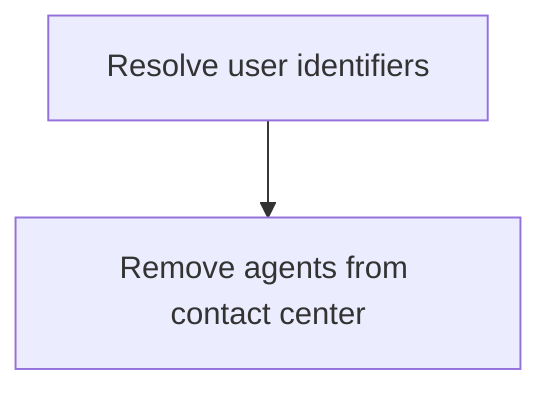

# Remove Agents from Contact Center

## When to Use This Skill

Use this skill when the user wants to remove, unassign, delete, or unenroll one
or more agents (users) from a Contact Center, also known as a Call Center. It
handles requests that identify the agents by User Id, email, username, first
or last name, or alias, and identify the contact center by its Id, display
name, or internal name.

## Workflow

1. Resolve every provided user identifier to a unique User ID.
2. Present the resolved users (with their User Ids) and the contact center as a
   draft, then stop and wait. Invoke the removal only after the user explicitly
   confirms in a later message — never in the same turn as the draft.
3. Remove the resolved agents from the specified contact center, passing only
   User Ids in userIdentifiers and the contact center identifier through
   unresolved.
4. Report the action's response as the result. The removal is asynchronous: an
   HTTP 200 with "We’re removing users from the contact center. Please give us a minute or two. We’ll send you an email when the process completes." certifies success — report it as a
   success and do not re-read User.CallCenterId or wait for the background job.

## Critical Constraints

**Preconditions:**
- One or more user identifiers for the agents to remove must be provided.
- A contact center identifier must be provided.
- The user must be a Contact Center admin or a Salesforce admin.
- The specified users must currently be associated with the specified contact
  center.

## Operations Reference

| Operation | Purpose | Call | Depends on |
|---|---|---|---|
| Resolve user identifiers | Resolve one or more user identifiers to unique User IDs | Resolve each user identifier (User Id, Email, UserName, FirstName, LastName, or Alias) to its User ID | - |
| Remove agents from contact center | Remove the resolved agents from the specified contact center | The Remove Agents from Contact Center action | Resolve user identifiers |

### Dependency graph

### Read operations

**Resolve user identifiers**
Looks up each provided user identifier and returns its unique User ID.
- **Call:** resolve each User identifier to its User ID
- **Inputs:**
  - The entity type being resolved — `User`.
  - User identifiers (list) — each in one of: User Id, Email, UserName,
    FirstName, LastName, or Alias. Can be provided as a comma-separated list.
- **Output:** The resolved unique User IDs.

### Write operations

**Remove agents from contact center**
Removes the resolved agents from the specified contact center.
- **Call:** the Remove Agents from Contact Center action
- **Inputs:**
  - User IDs (list) — the User IDs resolved in the previous step.
  - Contact center identifier (string) — a CallCenter Id, display name, or
    internal name, passed through as provided without resolution.
- **Output:** A response describing the result of removing the agents from
  the contact center.
- **Depends on:** Resolve user identifiers.

## Notes

- User identifiers can be provided as a comma-separated list.
- Each identifier can be in any of these formats: User Id, Email, UserName,
  FirstName, LastName, or Alias.
- The contact center identifier can be a CallCenter Id, display name, or
  internal name.
- User identifiers are resolved to User IDs before being passed to the
  removal call; the contact center identifier is not resolved.

<!-- skill-validate: ignore-start -->
<!-- codey:operations start -->
## Operations Reference

Operations this skill uses — routing and dependency reference.

| Operation | Purpose | Status | Call | Depends on |
|-----------|---------|--------|------|------------|
| `resolve-user-identifiers` | read | implemented | `GET /services/data/v67.0/query` | — |
| `remove-agents-from-contact-center` | write | implemented | `POST /services/data/v67.0/headless/invocableaction` | `resolve-user-identifiers` |
| `verify-agents-removed-from-contact-center` | verify | implemented | `GET /services/data/v67.0/query` | `remove-agents-from-contact-center` |
<!-- codey:operations end -->
<!-- skill-validate: ignore-end -->
